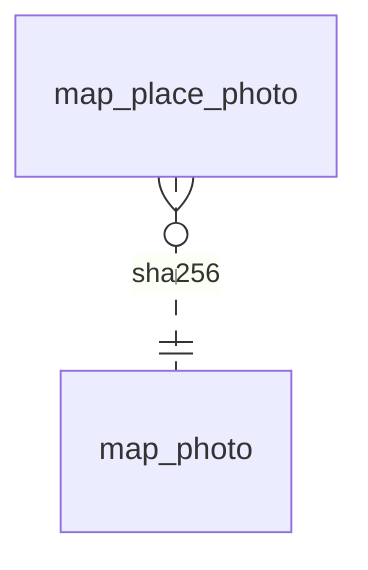

<!-- Generated by integration/db-schema-reference.ts - do not edit. Run: bun run db:docs -->

# `map_photo`

Source: [src/lib/map/store.ts](../../../src/lib/map/store.ts)

## Columns

| Column         | Kind                    | Database type | Nullable | Default | References |
| -------------- | ----------------------- | ------------- | -------- | ------- | ---------- |
| `sha256`       | Free text (primary key) | `TEXT`        | Yes      | –       | –          |
| `content_type` | ENUM                    | `TEXT`        | No       | –       | –          |
| `width`        | Integer                 | `INTEGER`     | No       | –       | –          |
| `height`       | Integer                 | `INTEGER`     | No       | –       | –          |
| `data`         | Binary                  | `BLOB`        | No       | –       | –          |

## Indexes

| Columns  | Unique | Origin      | Partial |
| -------- | ------ | ----------- | ------- |
| `sha256` | Yes    | primary key | No      |

## Referenced by

| Table             | Column   | Points to |
| ----------------- | -------- | --------- |
| `map_place_photo` | `sha256` | `sha256`  |

## Relations

