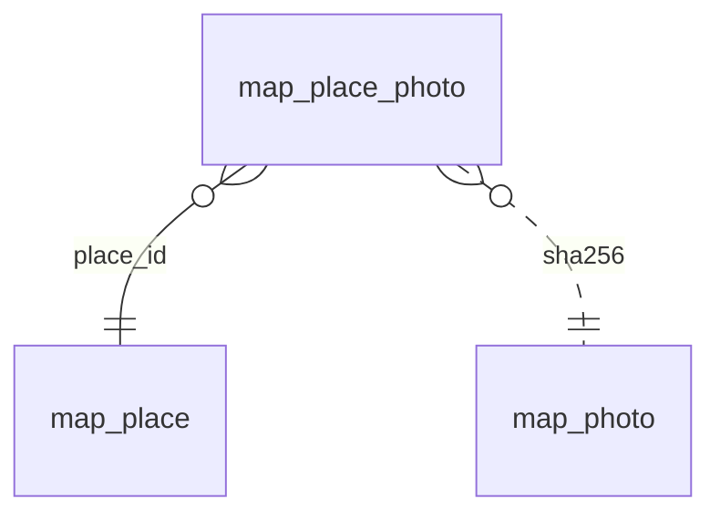

<!-- Generated by integration/db-schema-reference.ts - do not edit. Run: bun run db:docs -->

# `map_place_photo`

Source: [src/lib/map/store.ts](../../../src/lib/map/store.ts)

## Columns

| Column     | Kind                    | Database type | Nullable | Default | References                           |
| ---------- | ----------------------- | ------------- | -------- | ------- | ------------------------------------ |
| `place_id` | Free text (primary key) | `TEXT`        | No       | –       | [`map_place`.`id`](map_place.md)     |
| `position` | Integer (primary key)   | `INTEGER`     | No       | –       | –                                    |
| `sha256`   | Free text (foreign key) | `TEXT`        | No       | –       | [`map_photo`.`sha256`](map_photo.md) |
| `caption`  | Free text               | `TEXT`        | Yes      | –       | –                                    |

## Indexes

| Columns                | Unique | Origin      | Partial |
| ---------------------- | ------ | ----------- | ------- |
| `place_id`, `position` | Yes    | primary key | No      |

## Referenced by

None.

## Relations

